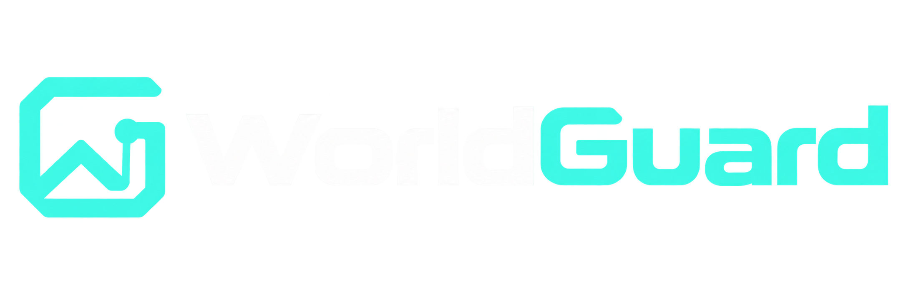
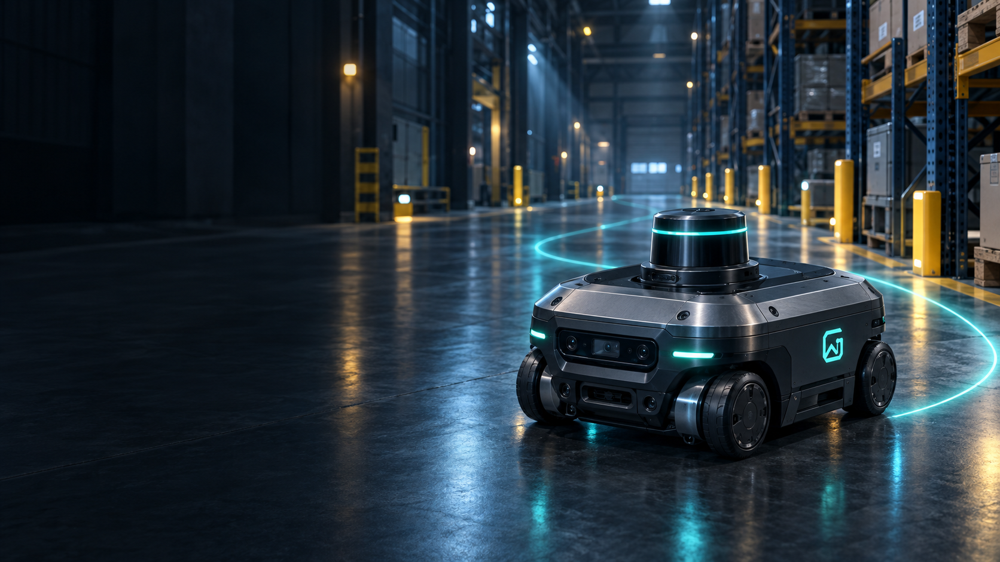
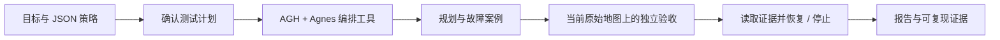

<p align="center"></p>

<h1 align="center">让导航策略接受测试，让恢复结果有据可查</h1>

<p align="center">AGH 工具编排 · 二维故障仿真 · 独立几何验收 · 原始失败与恢复对照</p>



WorldGuard 是室内导航策略评测工作台。输入测试目标、上传受限 JSON 策略，确认计划后运行正常通行、堵路与通道边界案例；查看路径、失败位置、恢复结果和可复核证据。

**零界智行 · 本科生组 U406 · 南京大学 / 东南大学**
此公开仓库于 2026-10-15 整理发布。开发历史来自独立工作区，本仓库不补造历史提交。头图为 AI 生成概念素材，不是实机照片。

## 先看什么

| 入口 | 内容 |
| --- | --- |
| [演示视频](https://www.bilibili.com/video/BV1dQJ66tEsV/) | 4 分 15 秒的真实操作演示 |
| [快速运行](worldguard/RUN.md) | React 工作台、API、离线与 LIVE 模式 |
| [项目报告](docs/WorldGuard-项目报告.pdf) | 问题、方法、实际结果与边界 |
| [技术指南](docs/WorldGuard-技术与复现指南.pdf) | 模型登记、环境、工具链与复现 |
| [正常 / 边界 / 失败样例](examples/README.md) | 实际保存的输入、结果、哈希与重放 |
| [AGH 接入](docs/AGH_SETUP.md) | 固定上游版本、官方模型配置及预算 |
| [验证记录](docs/VALIDATION.md) | 本轮检查与尚未完成的验收 |

## 核心流程



模型组织实验与读取反馈；规划器计算路径，独立验收器检查整条线段的机器人足迹。恢复必须重新验收，原始失败始终保留。地图、约束、目标或路径发生变化时，旧凭据不能沿用。

## 本地体验

需要 Python ≥3.11、Node.js ≥24.10（LIVE AGH 要求）；本轮验收环境是 Windows。

```powershell
git clone https://github.com/Yu-han-Shu/WorldGuard.git
cd WorldGuard/worldguard
python -m venv .venv
.\.venv\Scripts\python.exe -m pip install -e ".[api,mcp]"
.\.venv\Scripts\python.exe -m worldguard.api --port 8520
```

另开终端，进入 `worldguard/frontend`：

```powershell
npm ci
$env:VITE_WORLDGUARD_API_URL = 'http://127.0.0.1:8520'
npm run dev -- --port 5173 --strictPort
```

打开 <http://127.0.0.1:5173/#agent>。默认离线模式不需要 Key；真实模型须按 [AGH 配置说明](docs/AGH_SETUP.md) 显式启用。依赖与上游未随仓库复制，首次安装需要网络。当前不提供公开托管的在线实例。

## 项目材料

[参赛提交总册](docs/WorldGuard-提交总册.pdf) · [技术与复现指南](docs/WorldGuard-技术与复现指南.pdf) · [真实 AGH 调用链](examples/agh-evidence/README.txt) · [三类样例](examples/README.md)

## 工程验证

全新 Linux CI 完成依赖安装、178 项 Python 测试、15 项保护层测试、前端测试及生产构建。[查看验证记录](https://github.com/Yu-han-Shu/WorldGuard/actions/runs/38674318227)。

## 已有实测

2026-10-15 两次已保存的 Agnes 运行使用模型 ID `agnes-3.0-flash`：

| 场景 | 案例 | 原始通过 | 恢复通过 | 停止 | 请求尝试 |
| --- | ---: | ---: | ---: | ---: | ---: |
| 复杂仓库，种子 90749 | 3 | 1 | 2 | 0 | 19 |
| 窄通道，种子 11 | 5 | 3 | 0 | 2 | 23 |

代表堵路案例的净空从 −0.230 m 变为 0.145 m，路径长度从 41.5 m 变为 48.0 m。指标来自保存结果，样例可离线重放。请求计数包含辅助请求，完整 token 与费用未知。停止不等于到达；这些少量案例不能证明 Agent 优于规则。

## 工程范围

- 单机器人二维几何仿真；未覆盖动力学、制动、定位误差或实机安全认证。
- JSON 策略可执行；上传 Python 仅静态检查，不执行任意代码。
- 含同场景参数比较、反事实实验与证据问答；未证明跨地图泛化收益。
- AGH 真实 Host 脱敏记录已保留；核心工具调用链可按事件序号、模型 ID 和工具 ID 核对。
- 历史 `experiments/final_v1` 是冻结离线实验，不能与上述 LIVE 结果混用。历史文档提到的私人工作区批次档案未公开打包。

## 目录

`worldguard/src` 业务与验收；`worldguard/frontend` 工作台；`worldguard/agh_plugin` 工具预算保护；`worldguard/tests` 自动检查；`examples` 代表案例；`docs` 发布材料。

## 来源与署名

使用官方 [Agnes Harness](https://github.com/AgnesAI-Labs/agnes-harness)，开发中使用 Codex 辅助，历史调试也使用过 `kimi-for-coding`。详见 [模型登记](worldguard/docs/AI_USAGE.md) 和 [来源说明](docs/WorldGuard-来源与使用说明.pdf)。界面视觉素材为 AI 生成，见 [素材记录](worldguard/frontend/public/assets/visual-v3/sources.json)。

成员：束宇涵（南京大学，地理科学）、何万里（南京大学，医学）、郑博文（东南大学，电气）。束宇涵负责项目统筹、场景与测试方案设计、工作台集成、报告与演示组织；何万里负责测试样例整理、异常场景与结果复核、使用体验检查和文档整理；郑博文负责导航策略与几何约束验证、AGH 工具链联调、复现测试与技术说明。

第三方组件遵循各自许可证；本项目独立代码的开源许可证尚待权利人确认，公开访问不代表额外授权。演示视频：[B站公开演示](https://www.bilibili.com/video/BV1dQJ66tEsV/)，2026-10-15 10:48:05 发布，播放器时长 04:15。
